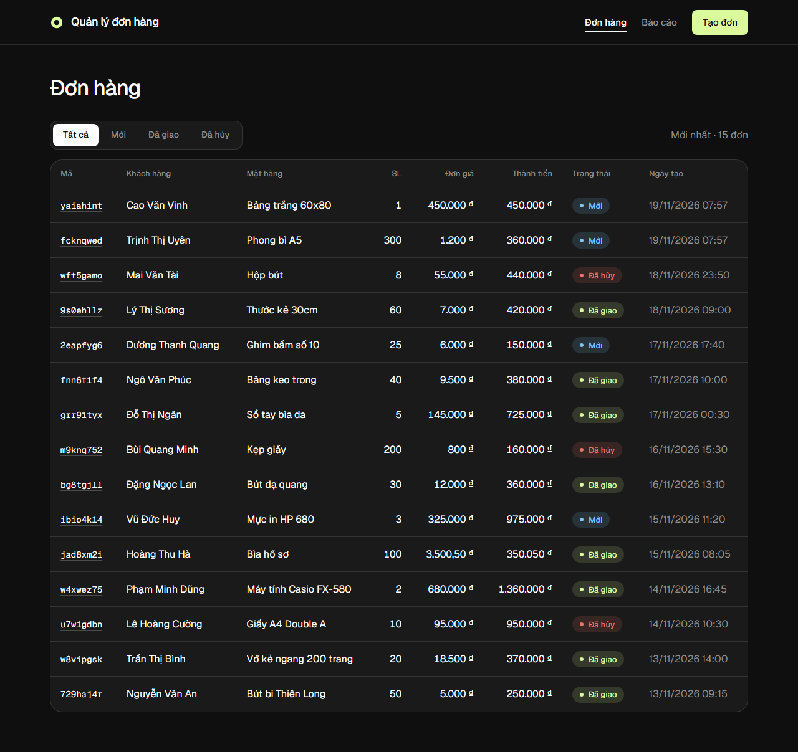
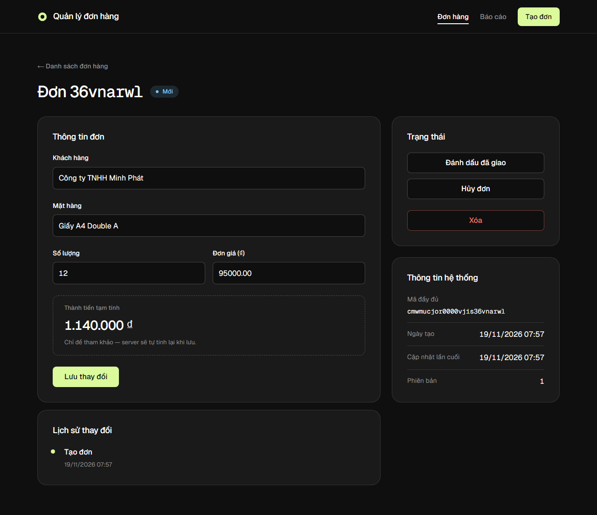

# Order Management

App nhỏ quản lý đơn hàng (tạo / sửa / đổi trạng thái / xóa) và báo cáo doanh thu theo ngày, có lịch sử thay đổi của từng đơn. Không có đăng nhập (xem *Giả định*).
Dùng **Next.js** thay vì Frappe vì đề cho phép framework quen thuộc: một codebase TypeScript cho cả API, giao diện và test, kiểm soát rõ ràng từng lớp kiểm tra ở server.



## Yêu cầu

- Node.js **22.12+**
- Docker (chạy PostgreSQL 16)
- Mạng Internet khi `npm run build` / `npm run e2e`: `next/font` tải font Geist (có bộ ký tự tiếng Việt) lúc build rồi tự phục vụ, trình duyệt không gọi Google Fonts

## Cài đặt & chạy

```bash
cp .env.example .env        # Windows PowerShell: Copy-Item .env.example .env
npm ci                      # tự chạy `prisma generate`
npm run db:up               # Postgres 16 trong Docker: orders_dev, orders_test, orders_e2e
npm run db:setup            # migrate + seed ~15 đơn mẫu vào orders_dev
npm run dev                 # http://localhost:3000
```

> Cổng 5432 phải còn trống. `npm run db:setup` chạy lại được nhiều lần (seed xóa đơn cũ rồi tạo lại).
>
> **Seed chỉ chạy trên database có tên đuôi `_dev`, `_test` hoặc `_e2e`.** Trỏ nhầm `DATABASE_URL` vào DB thật thì seed từ chối chạy (muốn ép thì đặt `ALLOW_SEED=1`).

Biến môi trường được kiểm tra **ngay khi server khởi động** ([instrumentation.ts](instrumentation.ts) → [lib/env.ts](lib/env.ts)): thiếu hoặc sai `DATABASE_URL` thì server dừng với thông báo rõ ràng, không đợi tới request đầu tiên mới lỗi.

## Chạy test

| Lệnh | Việc |
|---|---|
| `npm test` | unit + integration (integration dùng DB `orders_test`, không đụng dữ liệu dev) |
| `npm run test:unit` / `npm run test:int` | chạy riêng từng loại |
| `npm run check` | typecheck + lint + test |
| `npm run e2e` | Playwright: tự build + chạy app ở cổng 3200 trên DB **`orders_e2e`** riêng |
| `npm run screenshots` | seed DB e2e rồi chụp lại ảnh vào `docs/screenshots/` |

Ba database tách biệt nên chạy `npm test` và `npm run e2e` cùng lúc vẫn an toàn (integration test `TRUNCATE` bảng của `orders_test`, không đụng tới server e2e). Lần đầu chạy e2e cần tải trình duyệt: `npx playwright install chromium`.

**CI** ([.github/workflows/ci.yml](.github/workflows/ci.yml)) gồm hai job:

1. `check`: `npm audit` (chặn advisory high/critical mới, xem mục *Rủi ro đã chấp nhận*) → migrate → `npm run check` → `npm run build`.
2. `e2e`: Playwright trên build production. Khi fail, CI upload `test-results/` để xem lại.

## API

Tiền trong JSON luôn là **string** (vd `"150000.00"`). Lỗi trả về `{ "error": "...", "fieldErrors"?: { "<field>": ["..."] } }`; riêng lỗi 500 trả thêm `requestId` để đối chiếu với log.

| Method | Path | Thành công | Lỗi |
|---|---|---|---|
| `GET` | `/api/health` | 200 | 503 khi DB không trả lời |
| `GET` | `/api/orders?status=&limit=&cursor=` | 200 `{ items, nextCursor }` | 400 |
| `POST` | `/api/orders` (header tùy chọn `Idempotency-Key`) | 201; gửi lại cùng key → 200 | 400 |
| `GET` | `/api/orders/:id` | 200 | 404 |
| `GET` | `/api/orders/:id/history` | 200 | 404 |
| `PATCH` | `/api/orders/:id` (body bắt buộc có `version`) | 200 | 400, 404, 409, 422 |
| `DELETE` | `/api/orders/:id?version=` | 204 | 404, 409, 422 |
| `POST` | `/api/orders/:id/status` | 200 | 400, 404, 409, 422 |
| `GET` | `/api/reports/revenue?from=YYYY-MM-DD&to=YYYY-MM-DD` | 200 | 400 |

```bash
B=http://localhost:3000/api

# Tạo đơn → 201. Gửi lại cùng Idempotency-Key (vd sau khi timeout) → 200, không tạo đơn trùng
curl -X POST $B/orders -H 'content-type: application/json' -H 'idempotency-key: 6f1c2b0e-tao-don-01' \
  -d '{"customerName":"Nguyen Van A","productName":"But bi","quantity":2,"unitPrice":"150000"}'

# Danh sách: mới nhất trước, 20 dòng/trang (tối đa 100); trang sau dùng nextCursor
curl "$B/orders?status=NEW&limit=20"
curl "$B/orders?limit=20&cursor=<nextCursor>"

# Chi tiết và lịch sử thay đổi
curl $B/orders/<id>
curl $B/orders/<id>/history

# Sửa đơn NEW: gửi đủ 4 field + version đang thấy → 409 nếu ai đó đã sửa trước, 422 nếu đơn đã chốt
curl -X PATCH $B/orders/<id> -H 'content-type: application/json' \
  -d '{"customerName":"Nguyen Van A","productName":"But bi","quantity":3,"unitPrice":"150000","version":1}'

# Đổi trạng thái: DELIVERED | CANCELLED (version tùy chọn) → 422 nếu đã chốt, 409 nếu vừa bị đổi ở nơi khác
curl -X POST $B/orders/<id>/status -H 'content-type: application/json' -d '{"status":"DELIVERED","version":2}'

# Xóa (mềm) đơn NEW → 204
curl -X DELETE "$B/orders/<id>?version=2"

# Báo cáo doanh thu (ngày giờ VN, gồm cả 2 đầu; bỏ trống = 30 ngày gần nhất)
curl "$B/reports/revenue?from=2026-11-01&to=2026-11-18"

# Health check cho load balancer / uptime monitor
curl $B/health
```

> Trên Windows (Git Bash/cmd), tham số dòng lệnh có thể không được gửi dưới dạng UTF-8 — dùng ví dụ không dấu như trên, hoặc `--data-binary @body.json`.

## Giả định

- Khách hàng và mặt hàng là **text tự do** (1–200 ký tự), không có bảng danh mục riêng. Mỗi đơn một mặt hàng.
- Tiền là **VND**, lưu `Decimal(18,2)`; đơn giá tối đa 2 chữ số thập phân. Số lượng là số nguyên `1 … 2 147 483 647`; thành tiền vượt quá `Decimal(18,2)` bị từ chối (400) thay vì lỗi DB.
- Sửa đơn = gửi lại **đủ 4 field** kèm `version` đang thấy; không hỗ trợ sửa từng phần. Lưu mà không đổi gì thì không tăng version và không ghi lịch sử.
- "Ngày" trong báo cáo và hiển thị là **giờ Việt Nam (UTC+7)**; DB lưu UTC. Báo cáo nhóm theo **ngày tạo đơn**, không phải ngày giao.
- Ngày không có đơn đã giao **không hiện dòng** trong báo cáo. Khoảng báo cáo tối đa 366 ngày; mặc định 30 ngày gần nhất tính tới hôm nay.
- Đơn đã chốt (Đã giao / Đã hủy) **không được sửa, đổi trạng thái hay xóa**. Chỉ đơn `NEW` xóa được, và xóa là **xóa mềm**: đơn biến mất khỏi danh sách/API (404) nhưng bản ghi và lịch sử vẫn còn trong DB.
- **Không có đăng nhập** (đề không yêu cầu): ai mở được app/API đều có toàn quyền, nên app chỉ nên chạy trong mạng nội bộ hoặc sau một lớp xác thực ở reverse proxy. Vì vậy lịch sử thay đổi ghi **cái gì và lúc nào**, không ghi **ai**.
- Idempotency-Key: gửi lại cùng key thì luôn trả về đơn đã tạo lần đầu, **không so sánh nội dung** request.

## Quyết định thiết kế

- **Một lớp service** ([lib/orders/service.ts](lib/orders/service.ts)) chứa toàn bộ nghiệp vụ. Route handler ([app/api](app/api)) và Server Action ([app/orders/actions.ts](app/orders/actions.ts)) chỉ đọc input → gọi service → map lỗi. Nhờ vậy API và giao diện tuân theo đúng cùng một bộ quy tắc.
- **Không tin client:** Zod ([lib/orders/schema.ts](lib/orders/schema.ts)) bỏ mọi field lạ (`amount`, `status`, `id`, `createdAt`). Server tự tính thành tiền và luôn tạo đơn ở trạng thái `NEW`.
- **Chống ghi đè (optimistic locking) và race:** mỗi đơn có cột `version`, tăng sau mỗi lần ghi. Mọi thao tác ghi chạy trong một transaction: đọc đơn → kiểm tra tồn tại / chưa chốt / đúng version client gửi → `updateMany` với `WHERE id AND status AND version = <vừa đọc>`. Nếu có request khác commit chen vào giữa, Postgres kiểm tra lại `WHERE` sau khi chờ khóa dòng, `count = 0` → **409**. Kết quả:
  - hai người cùng bấm "Đã giao" và "Hủy": đúng một người thắng;
  - hai người cùng sửa một đơn: người lưu sau nhận 409 thay vì âm thầm ghi đè.
  Có integration test chạy đồng thời cho cả hai trường hợp, và e2e mở hai tab.
- **Lịch sử thay đổi (audit trail):** bảng `order_events` ghi thay đổi gì, lúc nào (`CREATED` kèm ảnh chụp dữ liệu, `UPDATED` kèm `{field: {from, to}}`, `STATUS_CHANGED`, `DELETED`), **trong cùng transaction** với thay đổi nên không thể có thay đổi mà thiếu lịch sử. Bảng chỉ cho ghi thêm: trigger Postgres chặn `UPDATE`/`DELETE`.
- **Idempotency:** `POST /api/orders` nhận `Idempotency-Key`, lưu vào cột `UNIQUE`. Hai request trùng key chạy đồng thời thì unique index chỉ cho một bản ghi, request còn lại đọc và trả đúng đơn đó. Form tạo đơn tự sinh key ở client cho mỗi lần mở form, tạo lúc bấm lưu chứ không lúc render, để key không bị nhúng vào HTML tĩnh dùng chung cho mọi người.
- **Phân trang keyset** theo `(created_at, id)` giảm dần, cursor mờ (base64url): ổn định khi có đơn mới chen vào, trang thứ 1000 nhanh như trang 1 (không `OFFSET`). Có index `(status, created_at, id)` và `(created_at, id)`.
- **Bảng `TRANSITIONS`** ([lib/orders/transitions.ts](lib/orders/transitions.ts)) mô tả máy trạng thái bằng dữ liệu; "đã chốt" = trạng thái không có cạnh đi ra.
- **Decimal cho tiền:** đơn giá đi từ string → `Prisma.Decimal`, không qua float; JSON trả tiền dạng string; tổng báo cáo cộng bằng Decimal, SQL ép `SUM(amount)::text`. Giao diện định dạng tiền bằng thao tác chuỗi ([lib/format.ts](lib/format.ts)).
- **DB là lớp phòng thủ thứ hai:** CHECK constraint `quantity > 0`, `unit_price > 0`, `version > 0` (migration viết tay), nên kể cả ghi vòng qua service cũng bị Postgres từ chối.
- **Lỗi map một chỗ** ([lib/http.ts](lib/http.ts)): `ZodError` 400, `NotFoundError` 404, `ConflictError` 409, `InvalidTransitionError`/`OrderLockedError` 422, còn lại 500 không lộ chi tiết.
- **Quan sát được (observability):**
  - log có cấu trúc, mỗi dòng một JSON ([lib/log.ts](lib/log.ts));
  - [proxy.ts](proxy.ts) gắn `x-request-id` cho mọi request (giữ id từ upstream nếu an toàn), trả về trong header và trong body lỗi 500;
  - lỗi ở trang / Server Action được ghi bởi `onRequestError` ([instrumentation.ts](instrumentation.ts)) kèm `digest`, và trang lỗi hiển thị đúng `digest` đó cho người dùng gửi cho hỗ trợ;
  - `/api/health` kiểm tra DB cho load balancer.
- **Timezone** ([lib/time.ts](lib/time.ts)): Việt Nam không có giờ mùa hè nên dùng offset cố định +7, không cần thư viện. Báo cáo lọc theo khoảng UTC nửa mở `[00:00 VN ngày from, 00:00 VN ngày sau to)` trên cột gốc (dùng được index), rồi nhóm theo `created_at AT TIME ZONE 'Asia/Ho_Chi_Minh'`. Có test cho biên 00:30 và 23:59:59 giờ VN.

## Rủi ro đã chấp nhận

| Rủi ro | Vì sao chấp nhận | Xem lại |
|---|---|---|
| `npm audit`: 3 cảnh báo *high* ở `deepmerge-ts` ([GHSA-ggr8-5vv4-36mx](https://github.com/advisories/GHSA-ggr8-5vv4-36mx)) qua `@prisma/config` của **Prisma CLI 6.x** | Chỉ được CLI dùng khi đọc cấu hình cục bộ lúc dev/deploy; dữ liệu request không bao giờ đi qua đó. Bản sửa đòi nâng lên Prisma 7 (đổi sang driver adapter + `prisma.config.ts`), là một nâng cấp riêng có kế hoạch. CI chặn mọi advisory high/critical **khác** ([.github/audit-allowlist.txt](.github/audit-allowlist.txt)). | 2027-02-19 hoặc khi nâng Prisma 7 |
| Không có xác thực: ai truy cập được app/API đều đọc và sửa được mọi đơn | Đề không yêu cầu đăng nhập; app dùng trong mạng nội bộ. Khi cần mở ra ngoài thì đặt xác thực ở reverse proxy (vd SSO) hoặc thêm đăng nhập vào app. | Trước khi mở ra Internet |

## Hướng mở rộng khi dữ liệu lớn

Báo cáo hiện quét bảng `orders` theo index `(status, created_at, id)`. Khi dữ liệu lớn có thể thêm bảng tổng hợp `daily_revenue(day, orders, revenue)`, cập nhật **trong cùng transaction** với lệnh đổi trạng thái sang `DELIVERED`. Cách này an toàn vì một đơn chỉ vào báo cáo đúng một lần (chỉ có cạnh `NEW → DELIVERED`) và không thay đổi sau đó (đơn đã giao bị khóa), nên không bao giờ phải trừ ngược.

## Chưa làm / có thể cải thiện

- Đăng nhập + phân quyền theo vai trò (khi đó lịch sử thay đổi ghi thêm người thực hiện).
- Tìm kiếm danh sách đơn.
- Bảng khách hàng và mặt hàng riêng; nhiều mặt hàng trong một đơn.
- Nâng Prisma 7 (gỡ cảnh báo audit ở trên).

## Ảnh chụp màn hình

| | |
|---|---|
| Danh sách đơn  | Tạo đơn (thành tiền tạm tính)  |
| Lỗi validate theo field  | Đơn mới: sửa / đổi trạng thái / xóa  |
| Đơn đã chốt (chỉ xem) + lịch sử thay đổi  | Báo cáo doanh thu  |
