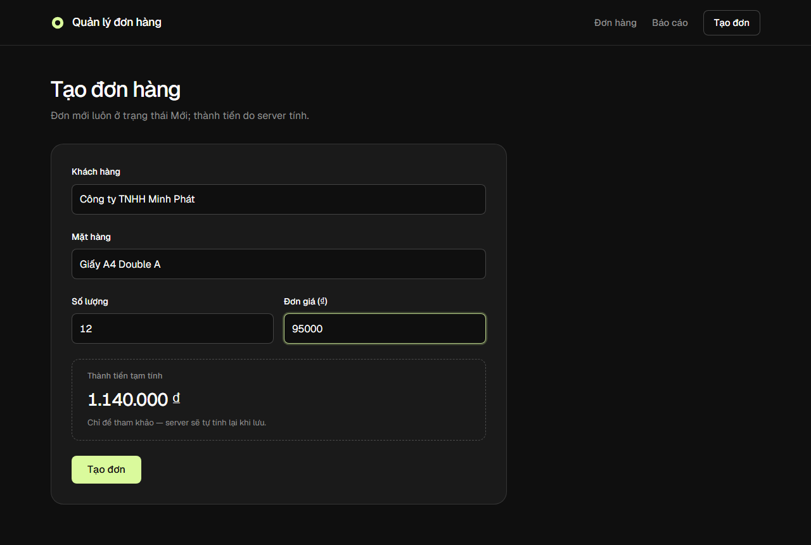
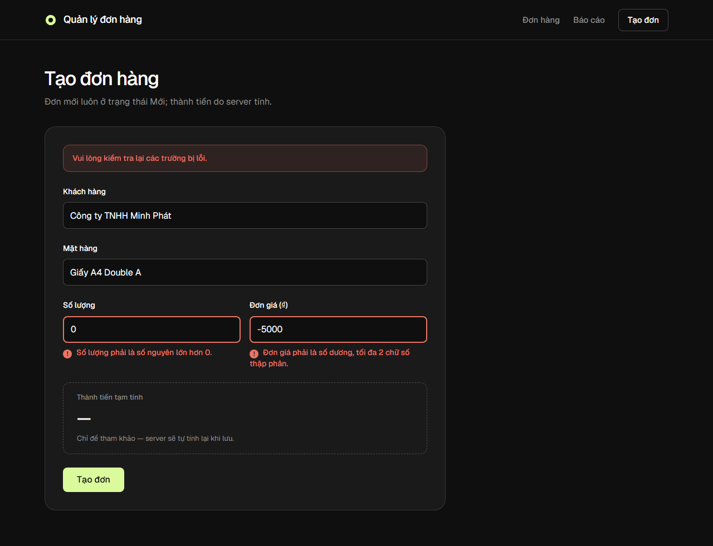
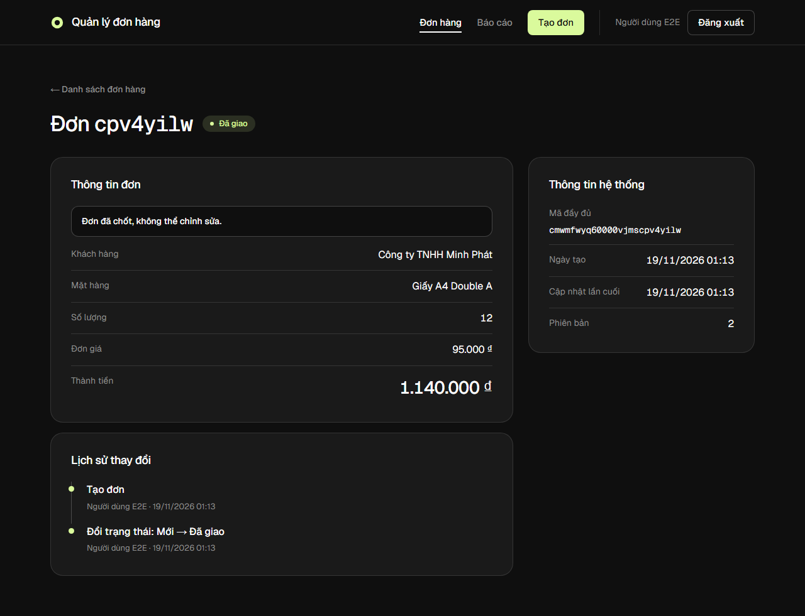
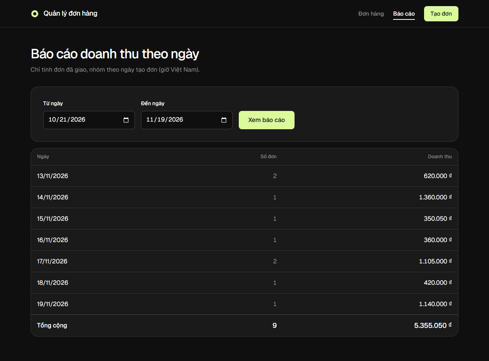

# Order Management

App nhỏ quản lý đơn hàng (tạo / sửa / đổi trạng thái / xóa) và báo cáo doanh thu theo ngày.
Dùng **Next.js** thay vì Frappe vì đề cho phép framework quen thuộc: một codebase TypeScript cho cả API, giao diện và test, kiểm soát rõ ràng từng lớp kiểm tra ở server.


## Yêu cầu

- Node.js **22.12+**
- Docker (chạy PostgreSQL 16)

## Cài đặt & chạy

```bash
cp .env.example .env        # Windows PowerShell: Copy-Item .env.example .env
npm ci                      # tự chạy `prisma generate`
npm run db:up               # Postgres 16 trong Docker, tạo sẵn 2 DB: orders_dev, orders_test
npm run db:setup            # migrate + seed ~15 đơn mẫu vào orders_dev
npm run dev                 # http://localhost:3000
```

> Cổng 5432 phải còn trống. `npm run db:setup` chạy lại được nhiều lần (seed xóa dữ liệu cũ trước khi tạo).

## Chạy test

| Lệnh | Việc |
|---|---|
| `npm test` | unit + integration (integration dùng DB `orders_test`, không đụng dữ liệu dev) |
| `npm run test:unit` / `npm run test:int` | chạy riêng từng loại |
| `npm run check` | typecheck + lint + test (CI chạy lệnh này) |
| `npm run e2e` | Playwright: tự build + chạy app ở cổng 3200 trên DB test |
| `npm run screenshots` | seed DB test rồi chụp lại ảnh vào `docs/screenshots/` |

Lần đầu chạy e2e cần tải trình duyệt: `npx playwright install chromium`.

## API

Tiền trong JSON luôn là **string** (vd `"150000.00"`). Lỗi trả về `{ "error": "...", "fieldErrors"?: { "<field>": ["..."] } }`.

| Method | Path | Thành công | Lỗi |
|---|---|---|---|
| `GET` | `/api/orders?status=NEW\|DELIVERED\|CANCELLED` | 200 | 400 |
| `POST` | `/api/orders` | 201 | 400 |
| `GET` | `/api/orders/:id` | 200 | 404 |
| `PATCH` | `/api/orders/:id` | 200 | 400, 404, 422 |
| `DELETE` | `/api/orders/:id` | 204 | 404, 422 |
| `POST` | `/api/orders/:id/status` | 200 | 400, 404, 409, 422 |
| `GET` | `/api/reports/revenue?from=YYYY-MM-DD&to=YYYY-MM-DD` | 200 | 400 |

```bash
B=http://localhost:3000/api

# Tạo đơn → 201 (amount/status client gửi lên bị bỏ qua)
curl -X POST $B/orders -H 'content-type: application/json' \
  -d '{"customerName":"Nguyen Van A","productName":"But bi","quantity":2,"unitPrice":"150000"}'

# Danh sách, lọc tùy chọn theo trạng thái
curl "$B/orders?status=NEW"

# Chi tiết → 404 nếu không tồn tại
curl $B/orders/<id>

# Sửa đơn NEW (gửi đủ 4 field) → 422 nếu đơn đã chốt
curl -X PATCH $B/orders/<id> -H 'content-type: application/json' \
  -d '{"customerName":"Nguyen Van A","productName":"But bi","quantity":3,"unitPrice":"150000"}'

# Đổi trạng thái: DELIVERED | CANCELLED → 422 nếu đơn đã chốt, 409 nếu vừa bị đổi ở nơi khác
curl -X POST $B/orders/<id>/status -H 'content-type: application/json' -d '{"status":"DELIVERED"}'

# Xóa đơn NEW → 204
curl -X DELETE $B/orders/<id>

# Báo cáo doanh thu (ngày giờ VN, gồm cả 2 đầu; bỏ trống = 30 ngày gần nhất)
curl "$B/reports/revenue?from=2026-11-01&to=2026-11-18"

# Dữ liệu sai → 400 kèm lỗi theo field
curl -X POST $B/orders -H 'content-type: application/json' \
  -d '{"customerName":"A","productName":"B","quantity":0,"unitPrice":"0"}'
```

> Trên Windows (Git Bash/cmd), tham số dòng lệnh có thể không được gửi dưới dạng UTF-8 — dùng ví dụ không dấu như trên, hoặc `--data-binary @body.json`.

## Giả định

- Khách hàng và mặt hàng là **text tự do** (1–200 ký tự), không có bảng danh mục riêng. Mỗi đơn một mặt hàng.
- Tiền là **VND**, lưu `Decimal(18,2)`; đơn giá tối đa 2 chữ số thập phân. Số lượng là số nguyên `1 … 2 147 483 647`; thành tiền vượt quá `Decimal(18,2)` bị từ chối (400) thay vì lỗi DB.
- Sửa đơn = gửi lại **đủ 4 field** (khách hàng, mặt hàng, số lượng, đơn giá); không hỗ trợ sửa từng phần.
- "Ngày" trong báo cáo và hiển thị là **giờ Việt Nam (UTC+7)**; DB lưu UTC. Báo cáo nhóm theo **ngày tạo đơn**, không phải ngày giao.
- Ngày không có đơn đã giao **không hiện dòng** trong báo cáo. Khoảng báo cáo tối đa 366 ngày; mặc định 30 ngày gần nhất tính tới hôm nay.
- Đơn đã chốt (Đã giao / Đã hủy) **không được sửa, đổi trạng thái hay xóa** — kể cả xóa. Chỉ đơn `NEW` xóa được.
- Không có đăng nhập / phân quyền.

## Quyết định thiết kế

- **Một lớp service** ([lib/orders/service.ts](lib/orders/service.ts)) chứa toàn bộ nghiệp vụ. Route handler ([app/api](app/api)) và Server Action ([app/orders/actions.ts](app/orders/actions.ts)) chỉ đọc input → gọi service → map lỗi. Nhờ vậy API và giao diện tuân theo đúng cùng một bộ quy tắc.
- **Không tin client:** Zod ([lib/orders/schema.ts](lib/orders/schema.ts)) bỏ mọi field lạ (`amount`, `status`, `id`, `createdAt`). Server tự tính thành tiền và luôn tạo đơn ở trạng thái `NEW`.
- **Update có điều kiện chống race:** sửa / đổi trạng thái / xóa dùng `updateMany`/`deleteMany` với `WHERE id = ? AND status = <trạng thái mong đợi>`. Postgres kiểm tra điều kiện và ghi trong cùng một câu lệnh, nên hai người cùng bấm "Đã giao" và "Hủy" thì đúng một người thắng; người kia nhận 409 (hoặc 422 nếu đọc sau khi đơn đã chốt). Có integration test chạy hai yêu cầu đồng thời.
- **Bảng `TRANSITIONS`** ([lib/orders/transitions.ts](lib/orders/transitions.ts)) mô tả máy trạng thái bằng dữ liệu; "đã chốt" = trạng thái không có cạnh đi ra.
- **Decimal cho tiền:** đơn giá đi từ string → `Prisma.Decimal`, không qua float; JSON trả tiền dạng string; tổng báo cáo cộng bằng Decimal, SQL ép `SUM(amount)::text`. Giao diện định dạng tiền bằng thao tác chuỗi ([lib/format.ts](lib/format.ts)).
- **DB là lớp phòng thủ thứ hai:** CHECK constraint `quantity > 0`, `unit_price > 0` (migration viết tay) — kể cả ghi vòng qua service cũng bị Postgres từ chối.
- **Lỗi map một chỗ** ([lib/http.ts](lib/http.ts)): `ZodError` 400, `NotFoundError` 404, `ConflictError` 409, `InvalidTransitionError`/`OrderLockedError` 422, còn lại 500 không lộ chi tiết.
- **Timezone** ([lib/time.ts](lib/time.ts)): Việt Nam không có giờ mùa hè nên dùng offset cố định +7, không cần thư viện. Báo cáo lọc theo khoảng UTC nửa mở `[00:00 VN ngày from, 00:00 VN ngày sau to)` trên cột gốc (dùng được index `(status, created_at)`), rồi nhóm theo `created_at AT TIME ZONE 'Asia/Ho_Chi_Minh'`. Có test cho biên 00:30 và 23:59:59 giờ VN.

## Hướng mở rộng khi dữ liệu lớn

Báo cáo hiện quét bảng `orders` theo index `(status, created_at)`. Khi dữ liệu lớn có thể thêm bảng tổng hợp `daily_revenue(day, orders, revenue)`, cập nhật **trong cùng transaction** với lệnh đổi trạng thái sang `DELIVERED`. Cách này an toàn vì một đơn chỉ vào báo cáo đúng một lần (chỉ có cạnh `NEW → DELIVERED`) và không thay đổi sau đó (đơn đã giao bị khóa), nên không bao giờ phải trừ ngược.

## Chưa làm / có thể cải thiện

- Đăng nhập & phân quyền.
- Phân trang / tìm kiếm danh sách đơn.
- Bảng khách hàng và mặt hàng riêng; nhiều mặt hàng trong một đơn.

## Ảnh chụp màn hình

| | |
|---|---|
| Danh sách đơn  | Tạo đơn (thành tiền tạm tính)  |
| Lỗi validate theo field  | Đơn mới: sửa / đổi trạng thái / xóa  |
| Đơn đã chốt (chỉ xem)  | Báo cáo doanh thu  |
